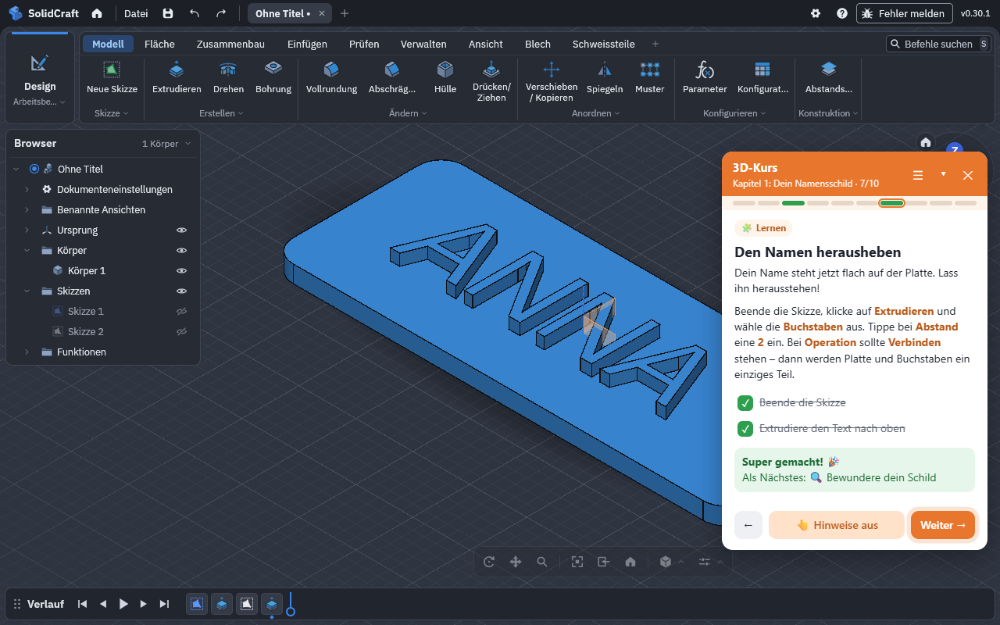

<p align="center"></p>

# Einführungskurs für SolidCraft – 3D-Konstruieren lernen

[](https://github.com/simonprell-dev/solidcraftAddon/actions/workflows/check.yml)
[](LICENSE)
[](https://simonprell-dev.github.io/solidcraftAddon/)

**[Projektseite](https://simonprell-dev.github.io/solidcraftAddon/)** ·
**[English](https://simonprell-dev.github.io/solidcraftAddon/en/)** ·
**[Flyer (PDF)](docs/flyer-de.pdf)** ·
**[Download](https://github.com/simonprell-dev/solidcraftAddon/releases/latest)** ·
**[Datenschutz](https://simonprell-dev.github.io/solidcraftAddon/datenschutz.html)**

Eine kostenlose Browser-Erweiterung für Chrome, Edge und Brave, die Kinder von 8 bis 14 Jahren
Schritt für Schritt durch das 3D-Konstruieren in [SolidCraft](https://app.solidcraft.io/) führt –
direkt im Editor, auf Deutsch oder Englisch, ohne Konto.

<p align="center"></p>

Sie funktioniert wie der [Einführungskurs für Scratch](https://simonprell-dev.github.io/scratchExtention/):

- **Kapitel mit Schritten**, jedes Kapitel endet mit einem eigenen, druckbaren Projekt
- **Eine Hand 👆 zeigt**, wo geklickt wird – auf Buttons, Felder im Dialog und Flächen im 3D-Modell
- **Automatische Prüfung**: Die Erweiterung erkennt, ob die Skizze offen ist, ob die Platte
  extrudiert wurde oder ob der Name heraussteht, hakt ab und wirft Konfetti 🎉
- **Drei Stufen** zum Einstieg, Fortschritt bleibt gespeichert

## Sprachen

Der Kurs gibt es auf **Deutsch** und **Englisch**. Er spricht automatisch die Sprache, in der
SolidCraft läuft (Einstellung in SolidCraft bzw. Browsersprache) – so passen die Button-Namen in
den Texten immer zur Oberfläche. Im Kursmenü (☰ → 🌍 Sprache) lässt sie sich fest einstellen.
Für andere SolidCraft-Sprachen zeigt der Kurs Englisch.

**Neue Sprache hinzufügen:**

1. `i18n/en.js` als `i18n/<code>.js` kopieren (z. B. `fr`) und übersetzen:
   `ui` (Kursfenster), `labels` (Tab- und Panel-Namen, wie SolidCraft sie in dieser Sprache zeigt),
   `course` (Titel und Text jedes Schritts) und `phrases` (alle kurzen Aufgaben-/Hinweistexte,
   Schlüssel ist der deutsche Text). Button-Namen aus `assets/locales/<code>.json` von SolidCraft nehmen.
2. Die Datei in `background.js` (`PAGE_SCRIPTS.js`) vor `course/i18n.js` eintragen.
3. `_locales/<code>/messages.json` für Name und Menü der Erweiterung anlegen.
4. `npm run check` meldet jede fehlende Übersetzung; `UI_LANG=<code> npm run e2e:chapters`
   spielt den Kurs in der neuen Sprache durch.

## Kursübersicht

| # | Projekt | Stufe | Neue Werkzeuge | Schritte |
|---|---|---|---|---|
| 1 | 🏷️ Namensschild | Neuling | Skizze, Rechteck, Extrudieren, Text | 10 |
| 2 | 🔑 Schlüsselanhänger | Neuling | Vollrundung, Bohrung | 7 |
| 3 | 🎲 Spielwürfel | Schon mal ausprobiert | Kreis, Ausschneiden, Abschrägung | 8 |
| 4 | ✏️ Stifteköcher | Schon mal ausprobiert | Hülle, Neuer Körper, Kombinieren | 9 |
| 5 | 📦 Box mit Deckel | Ich kenne mich aus | zwei Teile, Spiel/Toleranz | 7 |
| 6 | 🚀 Rakete | Ich kenne mich aus | Linie, Drehen, Radiales Muster | 9 |

Zusammen 6 Kapitel mit 50 Schritten. Die Stufen starten bei Kapitel 1, 3 bzw. 5 – alle Kapitel bleiben jederzeit erreichbar.

## Benutzung

1. Erweiterung installieren (siehe unten) und auf das Symbol klicken – SolidCraft öffnet sich.
2. Unten auf **🎓 3D-Kurs starten** klicken und eine Stufe wählen.
3. Dem Kursfenster folgen. Es lässt sich verschieben (Kopfzeile ziehen) und einklappen.

Rechtsklick auf das Symbol: Erweiterung aus-/einschalten, Lernfortschritt zurücksetzen.

### Entpackt installieren (Entwicklung)

1. Repository herunterladen.
2. `chrome://extensions` (bzw. `edge://extensions`) öffnen, **Entwicklermodus** einschalten.
3. **Entpackte Erweiterung laden** → diesen Ordner wählen.
4. SolidCraft-Tab neu laden (F5).

## Wie es funktioniert

SolidCraft zeichnet seine ganze Oberfläche in ein `<canvas>` – es gibt keine HTML-Buttons.
Die Web-App bietet aber eine offizielle Browser-Schnittstelle `window.solidcraft`. Die
Erweiterung liest darüber alle 200 ms (nur lesend, sie verändert das Modell nie):

- `ui.handles` – Bildschirmposition jedes Buttons, Tabs und Dialogfelds → dorthin zeigt die Hand
- `ui.inspect` – aktives Werkzeug, offener Dialog, Kamera
- `document.inspect` – Skizzen, Körper mit Maßen, Zeitleiste → damit werden Aufgaben geprüft
- `ui.at` – Bildschirmpunkt einer Ebene oder eines 3D-Punkts (z. B. die Oberseite der Platte)

| Datei | Aufgabe |
|---|---|
| `lib/solidcraft-access.js` | Zugriff auf `window.solidcraft`, ein Snapshot pro Takt |
| `course/context.js` | Prüf-Hilfen `c.inSketch()`, `c.height()`, `c.top()` … |
| `course/targets.js` | Hinweis-Ziele (`tool:solid.extrude`, `plane:XY` …) → Bildschirmpunkt |
| `course/course-data.js` | **Kursinhalte** (Deutsch) – für neue Kapitel nur diese Datei ändern |
| `course/i18n.js`, `i18n/*.js` | Sprachen: Erkennung, Oberflächentexte, Übersetzungen der Kursinhalte |
| `course/course.js` | Kursfenster, Hand, Stufenwahl, Konfetti |

## Entwicklung

```sh
npm install
npm test        # Unit-Tests (node:test)
npm run check   # prüft die Kursdaten
npm run e2e     # spielt Kapitel 1 in der echten Web-App durch (Edge/Chromium, Erweiterung geladen)
npm run e2e:robust  # Zurück, Neuladen, zwei Tabs, verdecktes Ziel, Pokal, Übergang
npm run e2e:chapters  # spielt die Kapitel 2–6 durch (einzeln: npm run e2e:chapters wuerfel; UI_LANG=en-US auf Englisch)
npm run e2e:english   # Kurs auf Englisch, Sprachwahl im Menü, Kurs folgt der SolidCraft-Sprache
```

`npm run e2e` braucht Edge oder Chromium: Google Chrome ab Version 137 lädt entpackte
Erweiterungen nicht mehr per Startparameter. Mit `HEADFUL=1` kann man zuschauen.

Mitmachen: siehe [CONTRIBUTING.md](CONTRIBUTING.md). Neue Kapitel schreibt man mit dem Skill [`.claude/skills/kurs-kapitel`](.claude/skills/kurs-kapitel/SKILL.md).

## Projektseite, Store und Werbung

| Was | Wo |
|---|---|
| GitHub-Seite (DE/EN) | [`docs/index.html`](docs/index.html), [`docs/en/index.html`](docs/en/index.html) – GitHub Pages aus `main` / `docs` |
| Datenschutzerklärung | [`docs/datenschutz.html`](docs/datenschutz.html), [`docs/en/privacy.html`](docs/en/privacy.html) |
| Flyer für Lehrkräfte | [`docs/flyer-de.pdf`](docs/flyer-de.pdf), [`docs/flyer-en.pdf`](docs/flyer-en.pdf) (Vorlage `docs/flyer.html`) |
| Logo | [`docs/logo.svg`](docs/logo.svg) → alle Symbole mit `npm run icons` |
| Store-Texte und -Bilder | [`docs/store/STORE-TEXTE.md`](docs/store/STORE-TEXTE.md), `docs/store/de/`, `docs/store/en/` |
| Pakete | `npm run pack` → `dist/solidcraft-kurs-<version>-store.zip` (Store) und `…zip` (manuell) |

Bilder neu erzeugen: `npm run screenshots` (echte Aufnahmen in SolidCraft, DE und EN) und danach
`npm run assets` (Werbekacheln, Vorschaubilder, Flyer-PDFs, Store-Screenshots).

## Lizenz

MIT. SolidCraft selbst ist ein eigenständiges Open-Source-Projekt (Apache-2.0) von Tangency Labs
und gehört nicht zu dieser Erweiterung.
